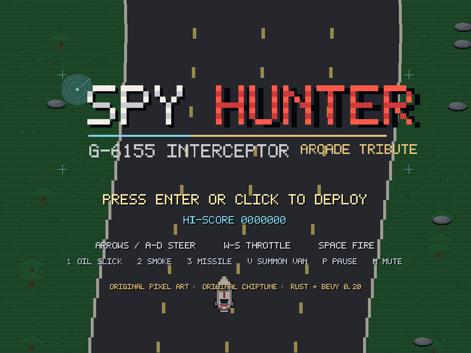
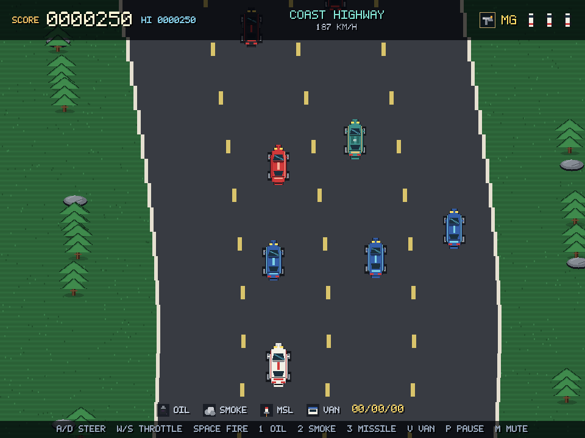

# SPY HUNTER: INTERCEPTOR

A 2D top-down vehicular-combat arcade game in **Rust + Bevy 0.20.1**, inspired by
Bally Midway's 1983 *Spy Hunter*. Drive the G-6155 Interceptor down a scrolling
freeway, protect civilians, shoot enemy traffic, board the weapons van, and
survive the car-to-boat transitions through highway, snow, water, and night-city
terrain.

> **Original work.** Every sprite, tile, and sound in this repository was made
> for this project with Krita, Python, and a small software synth. No ROM,
> cabinet, or arcade asset is included, and the music is an original spy-surf
> chiptune rather than the copyrighted *Peter Gunn* theme.




## Play

- **Browser:** <https://orbitmechanic.github.io/spy-hunter-web/>
- **Desktop:** `cargo run --release`

### Controls

| Action | Keys |
| --- | --- |
| Steer | `A` / `D` or arrow keys |
| Throttle / brake | `W` / `S` or up/down |
| Machine gun | `Space` or `J` (hold) |
| Oil slick / flamethrower | `1` or `U` |
| Smoke screen | `2` or `I` |
| Surface-to-air missile | `3` or `O` |
| Summon weapons van | `V` when **VAN READY** flashes |
| Pause | `P` |
| Mute | `M` |
| Start / restart | `Enter`, `Space`, or click |

Touch controls appear automatically on phones and tablets.

## What is in the game

- Four hand-authored terrains: **Coast Highway**, **Alpine Pass**, **Delta
  Waterway** (the Interceptor becomes a speedboat), and **Night City**.
- Four-lane scrolling highway with curves, lane traffic, roadside scenery, and
  a recycled pixel-art world.
- Enemy traffic, civilian cars, switchblade gun cars, pursuing boats, and a
  bombing helicopter.
- Machine gun, oil slicks (flamethrower at sea), smoke screens, homing
  missiles, and the weapons van.
- Civilian-hit score freeze, off-road penalty, craters, extra interceptors at
  score thresholds, high score, and an endless difficulty ramp.
- Original 23-second chiptune loop plus ten synthesized arcade SFX.
- Title, pause, game-over, and in-game HUD built with Bevy UI.

## Build and test

```sh
cargo run                 # desktop, dev profile
cargo test                # deterministic simulation tests
cargo clippy --all-targets -- -D warnings
cargo build --release
```

Bevy 0.20.1 needs Rust 1.97+; this project uses edition 2024.

### Screenshot harness

The binary can render a frame and exit, which is how the README images were
verified:

```sh
cargo run -- --screenshot shots/title.png --frame 200
cargo run -- --start --screenshot shots/game.png --frame 520
cargo run -- --start --terrain water --screenshot shots/water.png --frame 500
cargo run -- --gameover --screenshot shots/gameover.png --frame 120
```

## Web build

```sh
rustup target add wasm32-unknown-unknown
# wasm-bindgen CLI must match the version in Cargo.lock
tools/build_web.sh
python3 -m http.server 8123 --directory web/dist
```

`tools/build_web.sh` builds `wasm-release`, runs `wasm-bindgen`, optimizes with
`wasm-opt -Oz` when available, and stages a GitHub Pages-ready folder in
`web/dist/`. The source lives here; the static build is published from the
separate [`spy-hunter-web`](https://github.com/orbitmechanic/spy-hunter-web)
repository.

## Art and audio pipeline

- `tools/krita_assets.py` — all sprites, terrain tiles, logo, and the 1200×750
  banner, drawn through Krita 6's Python API. Run it with:
  `~/.agents/skills/krita/scripts/kritarun.sh tools/krita_assets.py`.
- `tools/make_font.py` — builds the 5×7 pixel TTF used by the HUD.
- `tools/make_audio.py` — synthesizes the chiptune loop and SFX as 22.05 kHz
  mono WAVs.

Source `.kra` boards are in `assets/art/` for hand editing.

## Layout

```
src/
  lib.rs     app wiring, states, capture harness
  art.rs     asset handles
  audio.rs   music and SFX
  game.rs    road, traffic, weapons, hazards, scoring
  ui.rs      title, HUD, pause, game over
assets/
  sprites/   cars, boats, helicopter, pickups, scenery
  backgrounds/ terrain tiles
  audio/     original chiptune + SFX
  fonts/     Interceptor pixel TTF
  art/       editable Krita boards, logo, banner
tools/       Krita, font, audio, web build, deploy
web/         browser shell and styles
```

## License

MIT. *Spy Hunter* is a trademark of its respective owners; this is an
unaffiliated fan tribute with entirely original assets.
